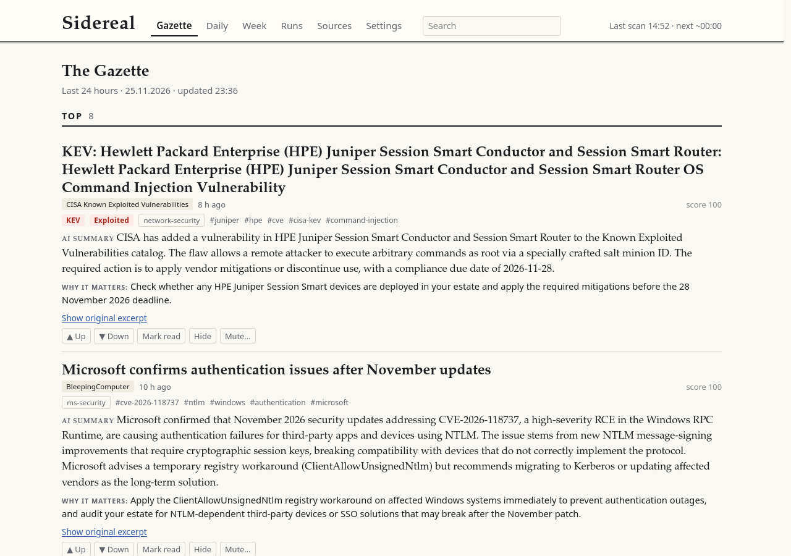
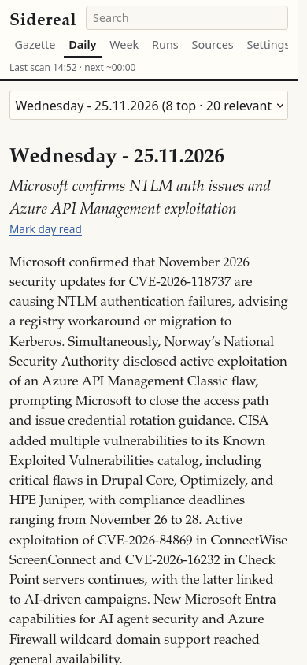

# Sidereal

**A self-hosted, AI-curated news gazette for cloud network and security people.**

Every four hours Sidereal reads around twenty sources, including Azure updates, Microsoft
security, MSRC, CISA's Known Exploited Vulnerabilities list, the security press and Hacker
News. A **local LLM** (via [Ollama](https://ollama.com)) judges each story against your focus
areas and writes a short summary with a "why it matters" line. Sidereal then publishes the
result as a calm, newspaper-style web page: **TOP**, **Relevant** and **On the side**, for the
last 24 hours and for every day before.

Nothing leaves your machine except the feed requests. There is no cloud LLM, no tracking and no
account to sign up for.

<p align="center">
  
  &nbsp;
  
</p>

## Features

- **Gazette**: a rolling 24-hour front page, sorted by score and freshness.
- **Daily**: one page per day (`Wednesday - 25.11.2026`) with a model-written digest and
  headline, plus a timeline of that day's scans.
- **Week**: a weekly digest, exportable as Markdown or printable to PDF.
- **Story cards**: an AI summary, *why it matters*, the sources, KEV / Exploited / CVSS
  badges, the focus area and tags, and the original excerpt.
- **Feedback**: ▲/▼ nudge future scores for similar sources and topics. *Hide* removes a story,
  *Mute* drops a source or keyword before it reaches the model, and *Mark read* dims it.
- **Search**: full-text search (SQLite FTS5) over titles, summaries, tags and excerpts.
- **Notifications**: new TOP stories go to a Discord webhook and/or email, with quiet hours.
- **Settings page**: edit focus areas and sources (with a "Test feed" button), tune scoring
  weights and budgets, and send test notifications.
- **Runs and Sources pages**: the stats for every scan, health per feed and a "Run now" button.
- **Polite with your GPU**: waits while another job (such as a coding agent) is using the
  model, unloads its models when done, and keeps within a per-run time budget.
- **Built to be safe with untrusted input**: article text is stored and shown as plain text
  only, and every fetch passes an SSRF guard. Optional login uses Argon2id passwords and TOTP,
  and the app refuses to bind beyond localhost unless login is on.

## How it works

```
 feeds & APIs ──► fetch (SSRF-guarded, conditional GET)
                   │
                   ▼
              normalise → plain text, canonical URLs, CVE ids
                   │
                   ▼
              dedupe into stories (URL / CVE / title similarity, MSRC roll-ups)
                   │
                   ▼
              keyword prefilter ──► LLM triage in batches (relevance 0–3)
                   │
                   ▼
              fetch article text ──► LLM assessment (rubric + summary + why it matters)
                   │
                   ▼
              score & bucket IN CODE (never by the model) ──► TOP / Relevant / Side / drop
                   │
                   ▼
              day & week digests ──► notifications ──► retention
```

The model only supplies numbers on a fixed rubric (relevance, urgency, actionability, novelty,
exploited in the wild) and the text. Placement is computed by plain, configurable code. KEV
listings, corroboration across sources, source weight, focus tier and your feedback all feed
the score.

## Requirements

- Linux with **systemd** (it runs as user services, never as root)
- **Python 3.12+** (developed on 3.13)
- **Node.js 20+**, only to build the web UI
- **Ollama** reachable from the machine, with a model that supports JSON-schema output.
  The default is `qwen3.8:27b`; any capable instruct model works.

## Quick start

```bash
git clone git@github.com:DroppedSyn/Sidereal.git ~/Projects/Sidereal
cd ~/Projects/Sidereal
```

Point Sidereal at your Ollama. Create `~/.config/sidereal/sidereal.toml`; every other setting
has a default, see `config/sidereal.example.toml`:

```toml
[ollama]
url = "http://127.0.0.1:11434"

[models]          # optional: pick your own models
triage = "qwen3.8:27b"
assess = "qwen3.8:27b"
digest = "qwen3.8:27b"
```

Then install:

```bash
./install.sh
```

The script sets up everything and is safe to re-run:

- the Python environment and the web UI build;
- the database;
- the `sidereal` command on your PATH;
- the services: the web app, a scan every 4 hours and a nightly backup;
- *lingering* (it asks before using sudo), so Sidereal keeps running when you log out;
- finally, a health check.

Open **http://127.0.0.1:8470** and press **Run now** on the Runs page for the first scan
(5–15 minutes, depending on your GPU).

From another machine, use an SSH tunnel: `ssh -L 8470:127.0.0.1:8470 you@host`.

To update, run `git pull && ./install.sh`. To remove it, run `./install.sh --uninstall`. That
stops and removes the services and keeps your data in `~/.local/share/sidereal`.

## Everyday commands

| Command | What it does |
|---|---|
| `sidereal doctor` | Health check: config, database, Ollama and models, sources, services, exposure |
| `sidereal run` | Run one scan now, in the terminal (`--dry-run` fetches only; `--source KEY` limits it to one source) |
| `sidereal rescore` | Recompute scores and buckets after changing weights (no LLM) |
| `sidereal backup` | Online database backup (nightly by timer; keeps 14) |
| `sidereal notify test` | Send a test notification |
| `sidereal user add NAME` | Create a login (see below) |
| `journalctl --user -u sidereal-run.service -n 100` | Logs of the last scans |

Scans run at 00:00, 04:00, 08:00, 12:00, 16:00 and 20:00 Europe/London (`deploy/sidereal-run.timer`).

## Configuration

- **`~/.config/sidereal/sidereal.toml`**: Ollama URL, models, budgets, scoring, schedule
  timezone, notifications, retention. Every key and its default is in
  `config/sidereal.example.toml`. Any key can also be set as an environment variable,
  `SIDEREAL_<SECTION>__<KEY>`.
- **Settings page**: focus areas, sources, and overrides for scoring, budgets and triage.
  These are stored in the database and take effect from the next scan.
- **`~/.config/sidereal/env`** (mode `600`): secrets only.

  ```
  SIDEREAL_DISCORD_WEBHOOK_URL=https://discord.com/api/webhooks/…
  SIDEREAL_SMTP_PASSWORD=…
  ```

  Enable channels with `[notify] channels = ["discord", "email"]` (SMTP host, user, from and to
  also go under `[notify]`), then run `sidereal notify test`.

## Login and LAN access

By default the app listens on `127.0.0.1` only, with no login. To share it on your network,
create a user (`sidereal user add NAME`, optionally `sidereal user totp NAME`), set
`[auth] mode = "on"`, and put it behind a TLS reverse proxy. `deploy/README.md` walks through
it, with an example Caddy config and a hardening checklist. The app refuses an exposed setup
without login.

## Development

```bash
.venv/bin/pytest -q                                   # back end (~2,200 tests, no network)
.venv/bin/ruff check src tests
cd web && npm test -- --run && npx tsc --noEmit && npx eslint src
web/e2e/run-smoke.sh                                  # headless Firefox smoke test (CSP, console)
.venv/bin/sidereal serve --reload & (cd web && npm run dev)   # live dev UI on :5173
```

Stack: FastAPI, httpx, pydantic, feedparser, trafilatura, SQLite (WAL + FTS5) · React 18,
TypeScript, Vite, React Query.

| Document | For |
|---|---|
| [`Sidereal_documentation.md`](Sidereal_documentation.md) | How it is built: pipeline, data model, API, security, maintenance recipes. Has a line-numbered table of contents for coding agents |
| [`AGENTS.md`](AGENTS.md) | Commands, file layout, rules and the design-decision log |
| [`deploy/README.md`](deploy/README.md) | Services, logs, backups and restore, authentication, LAN deployment |
| [`Sidereal_implementation_plan.md`](Sidereal_implementation_plan.md) | The original specification |
| [`PROJECT_LOG.md`](PROJECT_LOG.md) | Build history and the first real runs |

Sidereal was built with AI coding agents: Claude (design review, most of the code, every
review) and a local Qwen coding model via pi for parts of the code.
